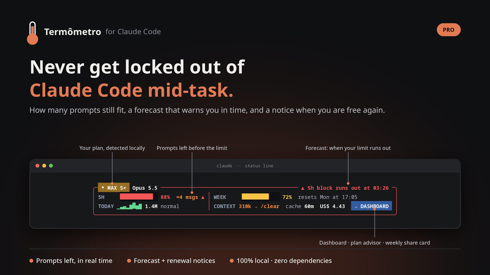
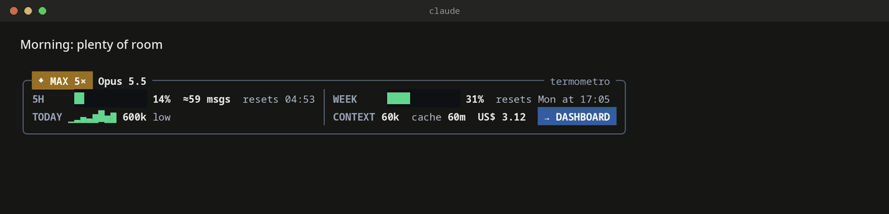
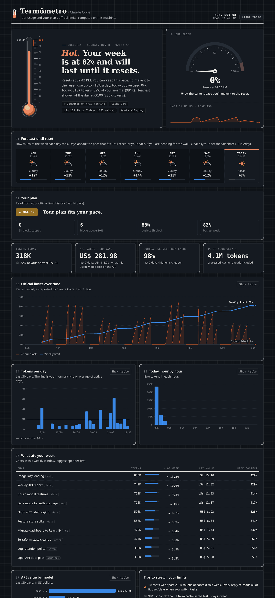
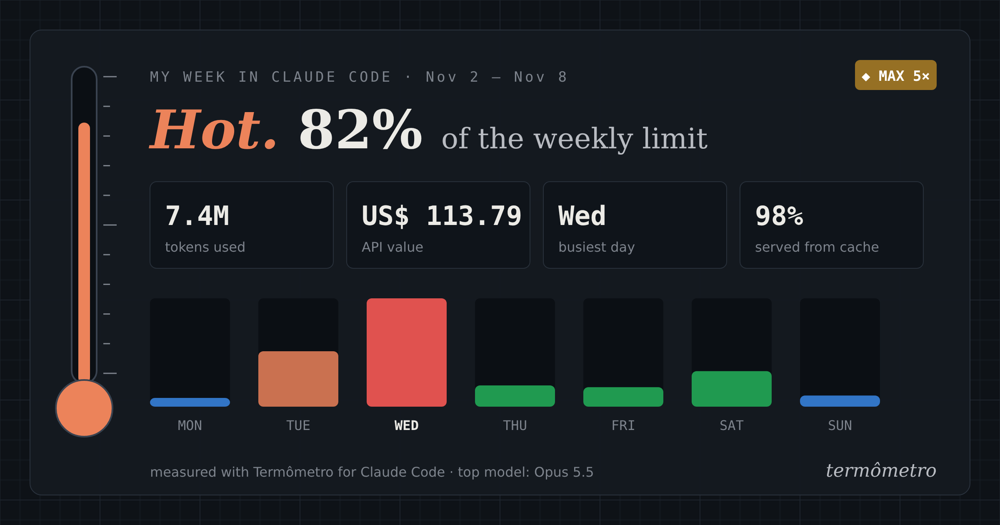

<p align="center"></p>

# Termômetro · never get locked out of Claude Code mid-task

[](https://github.com/leomagalhaesti/termometro/actions/workflows/tests.yml)

Claude Code already passes your **official** 5-hour and weekly limit percentages to the status line.
Termômetro turns them into the answer that matters: *will I make it until the reset?*

<p align="center"></p>

## Two versions

| | **Lite** (free, this repo) | **Pro** |
|---|:---:|:---:|
| Official 5h and weekly limits, framed panel, plan badge | ✓ | ✓ |
| Context size of the current chat + `/clear` hint | ✓ | ✓ |
| Today's tokens against your own normal | ✓ | ✓ |
| Light, dark and narrow terminals · English and Portuguese | ✓ | ✓ |
| **≈ prompts left** before the limit, calibrated on your recent use | | ✓ |
| **Forecast**: "5h block runs out at 15:20" while there is time to slow down | | ✓ |
| Desktop notice before the limit and when a block renews | | ✓ |
| Offline dashboard: limit history, API-equivalent cost per model, chats that ate your week | | ✓ |
| Plan advisor (is your plan tight or oversized?) and a weekly share card | | ✓ |
| `/termometro` command inside Claude Code | | ✓ |

**Get Pro:** [skillhq.dev/skills/leomagalhaesti/termometro](https://skillhq.dev/skills/leomagalhaesti/termometro)

## Install Lite

```bash
git clone https://github.com/leomagalhaesti/termometro.git
cd termometro/lite
python3 install.py              # backs up ~/.claude/settings.json first
python3 install.py --uninstall  # restores your previous status line
```

Or with the SkillHQ CLI: `skillhq install leomagalhaesti/termometro-lite`

Requirements: Python 3.8+, nothing else. `NO_COLOR=1` turns colors off.

## Dashboard (Pro)

<p align="center"></p>
<p align="center"></p>

## Privacy

Everything runs on your machine. Termômetro reads your local chat logs in `~/.claude` and the plan
field of `~/.claude.json`. It never reads credentials, tokens or API keys, and makes no network calls.

## Design decisions

- **Zero dependencies.** One Python file for the status line; it renders in about 40 ms.
- **Color only when something needs attention.** Calm by default, loud only near a limit.
- **Safe install.** The installer backs up your settings and restores your previous status line on uninstall.
- **Tested automatically** on Linux, macOS and Windows (Python 3.12, plus 3.10 on Linux) on every change. See the badge above.

## License

Lite is free to install and use, personal or commercial. Redistribution and resale are not allowed.
See [LICENSE](LICENSE). Images show demo data.

Built by [Leonardo Magalhães](https://www.linkedin.com/in/leomagalhaesti).
